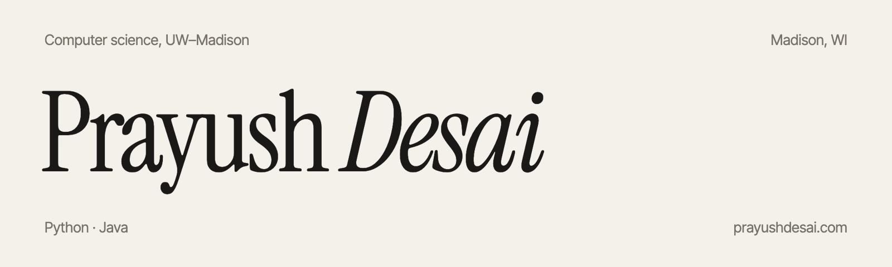

 

I study computer science at UW–Madison, class of ’29, and mostly write Python and Java.

Right now I’m building **Smart Scheduler**, a Flask app that takes the courses you want and returns every conflict-free weekly schedule, ranked by credit load, gaps between classes and how early you have to wake up. A small scikit-learn model estimates each course’s workload, so it can warn you before you overload.

Before that I built coursework projects in Java: a red-black tree, the backend for a game leaderboard, and a small version-control system with its own stack and queue.

 

[Website](https://prayushdesai.com) &nbsp;·&nbsp; [LinkedIn](https://linkedin.com/in/prayushdesai) &nbsp;·&nbsp; [Email](mailto:pdesai25@wisc.edu)
